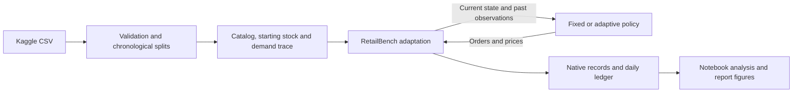

# Can LLMs Adapt to Business Shocks?

**A reproducible retail decision-science project: data validation, simulation,
inventory and pricing policies, and controlled business-shock experiments.**

[](https://github.com/DnyChillTypin/llm-business-shocks-sim/actions/workflows/tests.yml)


**Status:** verified Kaggle-driven RetailBench integration, two rule-based
policies, four scenarios, 19 automated tests, and two executed research notebooks.
LLM experiments and broader benchmark reruns are planned; current results are
baseline simulations, not LLM performance claims.

The three native repositories now have a local launcher, verified dependencies
and readiness checks. Gateway JSON responses and native RetailBench streaming
have been tested. See [benchmark setup](docs/BENCHMARKS.md) and the
[setup notebook](notebooks/02_benchmark_setup.ipynb) before starting paid runs.

The staged execution plan is in [docs/EXECUTION_PLAN.md](docs/EXECUTION_PLAN.md).
Stage 0 verification and rerun instructions are in [docs/STAGE0_HANDOFF.md](docs/STAGE0_HANDOFF.md).
Completed stages and meaningful milestones are committed and pushed to GitHub.

## The business question

How should a retailer adjust replenishment and prices when demand rises, demand
falls, or deliveries slow down? Can an LLM eventually improve on transparent
rules under the same information and constraints?

## Data science work demonstrated

- Validate 76,000 synthetic records across 100 store-product series and verify
  downloaded inputs by SHA-256.
- Use chronological 60/20/20 splits, training-only series selection, and identical
  starting conditions and external demand across policies.
- Integrate real inventory, ordering and delivery machinery while separating
  observations from explicit price-response and supplier assumptions.
- Evaluate contribution, fill rate, stockouts and inventory; reconcile contribution
  against changes in cash and inventory/pipeline assets.
- Provide pinned source versions, automated setup, SQLite records, action logs,
  integration tests and GitHub Actions.

## Pilot results

The pilot uses **S004 / P0006**, selected by median training demand variability.
Each policy runs 21 days, with shocks on days 8–14 and recovery on days 15–21:
**8 episodes / 168 simulated policy-days**.

| Scenario | Fixed contribution | Adaptive contribution | Difference | Fixed fill rate | Adaptive fill rate |
|---|---:|---:|---:|---:|---:|
| Control | 35,458.47 | 35,559.30 | +0.28% | 100.00% | 100.00% |
| Demand surge | 41,231.56 | 42,480.12 | +3.03% | 98.50% | 100.00% |
| Demand decline | 31,653.81 | 31,771.25 | +0.37% | 100.00% | 100.00% |
| Delivery disruption | 32,522.24 | 33,048.50 | +1.62% | 91.66% | 92.85% |

Contribution is revenue minus cost of goods sold and holding costs, in the
dataset's unspecified monetary units. Differences compare adaptive against fixed
within each scenario. This single-series pilot does not establish a general or
statistically significant advantage. Prices change demand, so fill rate and
contribution must be interpreted together.


The adaptive rule still runs out of stock during delivery disruption, providing
a concrete failure case for future LLM comparisons.


[Saved results](docs/results/baseline_summary.csv) ·
[Pilot manifest](docs/results/pilot_manifest.json) ·
[Source attribution](docs/THIRD_PARTY.md)

## Fresh-clone setup

Requires Git, Python 3.12 and internet access for the initial source/data setup.
No API keys or paid calls are needed for the current notebook.

```powershell
git clone https://github.com/DnyChillTypin/llm-business-shocks-sim.git
cd llm-business-shocks-sim
py -3.12 -m venv .venv
.\.venv\Scripts\python.exe -m pip install -r requirements-research.txt
.\.venv\Scripts\python.exe scripts/setup_project.py
.\.venv\Scripts\python.exe -m unittest discover -s tests -v
```

On macOS/Linux, create the environment with `python3.12 -m venv .venv` and use
`.venv/bin/python` for the remaining commands. The setup script obtains only the
pinned RetailBench code and small Kaggle dataset; it skips the 29 GB historical
LFS artifacts. Existing vendor checkouts are not rewritten.

## Explore the notebook

Open [the executed notebook](notebooks/01_kaggle_retailbench_integration.ipynb)
in VS Code. Select the project `.venv` interpreter as its kernel and run cells
in order. Saved outputs can also be viewed on GitHub. To run from a fresh kernel:

```powershell
.\.venv\Scripts\python.exe scripts/verify_notebook.py
```

Each execution creates a separate results session. The notebook prepares data,
checks native transitions, runs validity tests, compares policies and exports
report-ready figures and LaTeX tables.

## Experiment flow



## Roadmap

- Add an LLM policy using the same observations, constraints and tools; measure
  validity, cost and performance against the baselines.
- Expand products/stores and repeated runs; check price-response sensitivity.
- Execute the agreed bounded task coverage for RetailBench, FirmBench and ICBE,
  documenting native benchmark runs separately from adaptations.
- Produce a LaTeX findings report with traceable figures and limitations.

## License and attribution

Our implementation is MIT licensed. External code and datasets retain their
own terms. RetailBench is credited for the simulation machinery; its source is
unmodified. See [third-party attribution](docs/THIRD_PARTY.md) and the
[detailed integration notes](docs/INTEGRATION.md).
