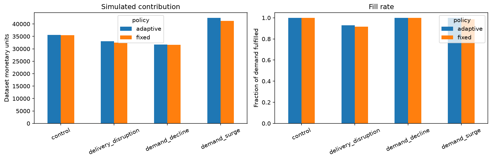
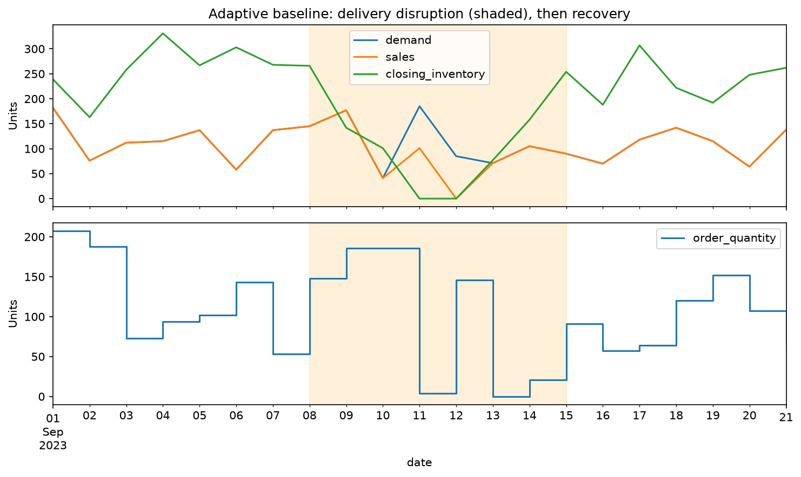
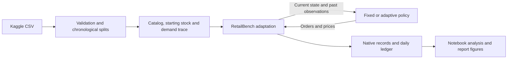

# Can LLMs Adapt to Business Shocks?

**A reproducible retail decision-science project: data validation, simulation,
inventory and pricing policies, and controlled business-shock experiments.**

[](https://github.com/DnyChillTypin/llm-business-shocks-sim/actions/workflows/tests.yml)


**Status:** [Stage 4 offline Kaggle readiness is complete](docs/STAGE4_EXECUTION.md).
Stage 3 retains 14 validated non-Retail tasks and the ICBE validity failure.
The project includes the Kaggle-driven RetailBench integration, genuine LLM validation
pilots, guarded native evaluations, automated tests and six executed research notebooks.
Primary Kaggle comparisons and the four full native Retail episodes remain outstanding.
See the [native evaluation plan](docs/STAGE3_EVALUATION.md),
[coverage table](docs/results/native_coverage.csv) and
[saved evaluation notebook](notebooks/05_native_evaluation.ipynb).

The three native repositories now have a local launcher, verified dependencies
and readiness checks. Gateway JSON responses and native RetailBench streaming
have been tested. See [benchmark setup](docs/BENCHMARKS.md) and the
[setup notebook](notebooks/02_benchmark_setup.ipynb) before starting paid runs.

The staged execution plan is in [docs/EXECUTION_PLAN.md](docs/EXECUTION_PLAN.md).
Stage 0 verification and rerun instructions are in [docs/STAGE0_HANDOFF.md](docs/STAGE0_HANDOFF.md).
Stage 1 freezes the [research design](docs/RESEARCH_DESIGN.md), [study configuration](configs/study.json),
and [planned coverage](docs/results/planned_coverage.csv). The [design notebook](notebooks/03_kaggle_llm_experiment.ipynb)
reproduces training-only selection and checks the freeze without running paid experiments.
Completed stages and meaningful milestones are committed and pushed to GitHub.

## The business question

How should a retailer adjust replenishment and prices when demand rises, demand
falls, or deliveries slow down? Can an LLM eventually improve on transparent
rules under the same information and constraints?

## Data science work demonstrated

- Validate 76,000 synthetic records across 100 store-product series and verify
  downloaded inputs by SHA-256.
- Use chronological 60/20/20 splits, training-only series selection, and identical
  starting conditions and external demand across policies.
- Integrate real inventory, ordering and delivery machinery while separating
  observations from explicit price-response and supplier assumptions.
- Evaluate contribution, fill rate, stockouts and inventory; reconcile contribution
  against changes in cash and inventory/pipeline assets.
- Provide pinned source versions, automated setup, SQLite records, action logs,
  integration tests and GitHub Actions.

## Pilot results

The pilot uses **S004 / P0006**, selected by median training demand variability.
Each policy runs 21 days, with shocks on days 8–14 and recovery on days 15–21:
**8 episodes / 168 simulated policy-days**.

| Scenario | Fixed contribution | Adaptive contribution | Difference | Fixed fill rate | Adaptive fill rate |
|---|---:|---:|---:|---:|---:|
| Control | 35,458.47 | 35,559.30 | +0.28% | 100.00% | 100.00% |
| Demand surge | 41,231.56 | 42,480.12 | +3.03% | 98.50% | 100.00% |
| Demand decline | 31,653.81 | 31,771.25 | +0.37% | 100.00% | 100.00% |
| Delivery disruption | 32,522.24 | 33,048.50 | +1.62% | 91.66% | 92.85% |

Contribution is revenue minus cost of goods sold and holding costs, in the
dataset's unspecified monetary units. Differences compare adaptive against fixed
within each scenario. This single-series pilot does not establish a general or
statistically significant advantage. Prices change demand, so fill rate and
contribution must be interpreted together.



The adaptive rule still runs out of stock during delivery disruption, providing
a concrete failure case for future LLM comparisons.



[Saved results](docs/results/baseline_summary.csv) ·
[Pilot manifest](docs/results/pilot_manifest.json) ·
[Source attribution](docs/THIRD_PARTY.md)

## Fresh-clone setup

Requires Git, Python 3.12 and internet access for the initial source/data setup.
No API keys or paid calls are needed for the current notebook.

```powershell
git clone https://github.com/DnyChillTypin/llm-business-shocks-sim.git
cd llm-business-shocks-sim
py -3.12 -m venv .venv
.\.venv\Scripts\python.exe -m pip install -r requirements-research.txt
.\.venv\Scripts\python.exe scripts/setup_project.py
.\.venv\Scripts\python.exe -m unittest discover -s tests -v
```

On macOS/Linux, create the environment with `python3.12 -m venv .venv` and use
`.venv/bin/python` for the remaining commands. The setup script obtains only the
pinned RetailBench code and small Kaggle dataset; it skips the 29 GB historical
LFS artifacts. Existing vendor checkouts are not rewritten.

## Explore the notebook

Open [the executed notebook](notebooks/01_kaggle_retailbench_integration.ipynb)
in VS Code. Select the project `.venv` interpreter as its kernel and run cells
in order. Saved outputs can also be viewed on GitHub. To run from a fresh kernel:

```powershell
.\.venv\Scripts\python.exe scripts/verify_notebook.py
```

Each execution creates a separate results session. The notebook prepares data,
checks native transitions, runs validity tests, compares policies and exports
report-ready figures and LaTeX tables.

## Experiment flow



## Roadmap

Stage 2 is complete: [19 native task pilots and two genuine Kaggle validation
episodes](docs/STAGE2_PILOTS.md), with **$0.869 conservative exposure across 237
attempts** under the $2 cap. The [executed analysis notebook](notebooks/04_results_analysis.ipynb)
records negative outcomes, repairs, fallbacks and retained failed-request charges.
The [full-scope base estimate](docs/COST_ESTIMATE.md) is $136.58 gateway credit;
the $6 inclusive first-draft route is now authorized for non-Retail evaluation,
with an allocation reserved for later Kaggle work. Native tasks run sequentially
with artifact review between tasks. The four full native Retail episodes remain
deferred, so completing this route does not complete the original Stage 3 scope.
Primary Kaggle comparisons have not started.

Stage 3's latest [QC checkpoint](docs/STAGE3_RESULTS.md) has **14 validated
non-Retail tasks**. ICBE stopped on a genuine invalid DeepSeek response after
177 valid rounds: its 4,096-token ceiling was exhausted without a decision.
The outcome was retained without resampling. Inclusive conservative exposure
is **$1.934 across 1,438 attempts**. The frozen ICBE failure is retained without
an amended run, while the four Retail evaluations remain deferred. The
[Stage 4 checkpoint](docs/STAGE4_EXECUTION.md) validates 24 baseline and 12 scripted
episodes across three series, with independent replay, matching inputs, strict
provenance and guarded primary execution. The [readiness notebook](notebooks/06_kaggle_experiment_readiness.ipynb)
loads saved evidence without paid calls. These are validation fixtures, not primary
LLM findings. [Stage 5 is prepared](docs/STAGE5_PREPARATION.md): the 36-episode
launch sequence, review gates and existing budget headroom are checked. No primary
episode has run; execution awaits a later instruction under the existing allowance.

- Validate the implemented LLM policy with genuine bounded pilots, then measure
  validity, cost and performance against the baselines under an evaluation budget.
- Expand products/stores and repeated runs; check price-response sensitivity.
- Execute the agreed bounded task coverage for RetailBench, FirmBench and ICBE,
  documenting native benchmark runs separately from adaptations.
- Produce a LaTeX findings report with traceable figures and limitations.

## License and attribution

Our implementation is MIT licensed. External code and datasets retain their
own terms. RetailBench is credited for the simulation machinery; its source is
unmodified. See [third-party attribution](docs/THIRD_PARTY.md) and the
[detailed integration notes](docs/INTEGRATION.md).
