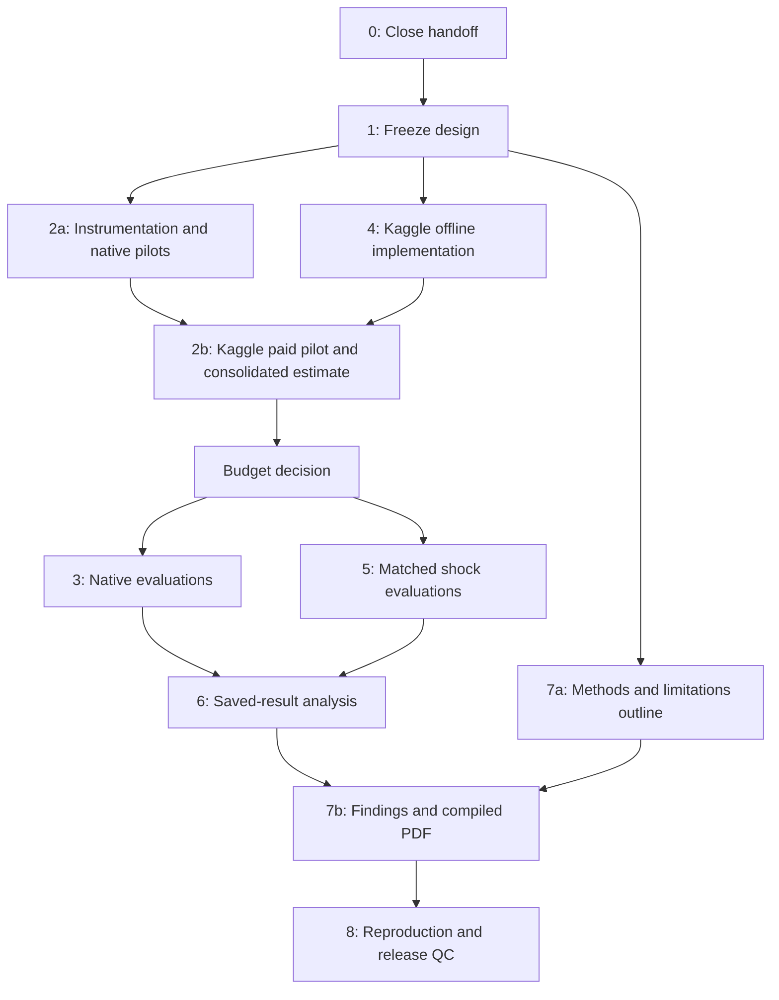

# Staged research execution plan

Project: **Can LLMs Adapt to Business Shocks? A Simulation-Based Study of AI-Assisted Strategic Decision-Making in Dynamic Business Environments**

Prepared from the local workspace on **17 October 2026 (Asia/Saigon)**, at project commit `88261b3`. This is an execution proposal, not experimental results. No paid API calls were made while preparing it. Accepting this plan starts staged work; it does not approve an unspecified API spend.

Stage 0 has since passed its local quality gates. See [the handoff checkpoint](STAGE0_HANDOFF.md) and [audit](results/handoff_audit.json) for current evidence. The inspection table below preserves the planning-time state, including uncertainties that Stage 0 resolved.

Stage 1 has frozen [design v1](RESEARCH_DESIGN.md), its configuration, prompts and case/episode manifests. The user's uncertainty about prior manual use of the primary window is recorded explicitly; no pristine unseen-data claim is allowed. The frozen design takes precedence over the original proposals below. Spending remains unapproved.

The practical target is a useful, explicitly preliminary findings PDF in 1–2 days. Full native coverage remains the completion target, but is not promised inside that window. Spend the first working day on verification, design, reliable logging, the Kaggle policy, and bounded pilots. Reserve time on day two for analysis and writing even if native runs remain incomplete.

## Evidence from this inspection

| Handoff claim | What was verified | Qualification / remaining check |
|---|---|---|
| Three pinned vendor repositories | All three HEADs match `configs/sources.json`; no tracked vendor changes | No rebuild or redownload needed |
| Approximately 29 GB RetailBench assets | Git LFS lists 93,958 checked-out assets totaling 29,010,737,647 bytes | Inventory verification, not a fresh hash of every large asset |
| Kaggle data | Re-read CSV: 76,000 rows, 100 series, 760 rows each; dates 2022-01-01–2024-01-30; SHA-256 matches the configured value | Synthetic data; price-response and shock mechanisms are assumptions |
| Python environment | `.venv` runs Python 3.12.14 | Installed dependency snapshot exists; most requirements are ranges rather than a complete lock |
| 19 launchable tasks | Present in `src/benchmarks/common.py`; launcher and worker inspected | Launchable does not mean completed with an LLM |
| 20 readiness checks | Published snapshot records 20 passes and all referenced evidence files exist | Original batch has one FormulaEval failure; snapshot incorporates the separate corrected `setup_debug/formula_real` rerun. Preserve that provenance |
| 19 tests passed | Existing suite has 19 tests | Fresh rerun stalled at `test_infinite_program_times_out`; interrupted without a final result. Do not claim a current 19/19 pass until resolved |
| Two notebooks executed | Notebook 01 has 9 executed code cells, notebook 02 has 5; saved outputs contain no error cells | Saved execution evidence, not a fresh execution in this inspection |
| CI passed | Workflow file exists and runs tests plus notebook 01 | Live GitHub status could not be retrieved. Notebook 02 is structurally checked by CI, not executed there |
| No full paid runs | No `results/benchmarks/` directory in this workspace | Historical gateway checks are separate; absence locally cannot establish account-wide spending history |
| Kaggle baselines / no LLM policy | Two policies and an eight-episode baseline matrix exist; no LLM policy implementation | Existing public pilot is exploratory, not a pristine unseen test |
| Report incomplete | No report directory found; `latexmk`, `pdflatex`, and `tectonic` not found on PATH | Check other installations or provision a compiler before the writing deadline |
| Secrets excluded | `.env` is ignored and untracked; contents were not printed | Full release scan remains Stage 8 |

Read: README; benchmark, integration and attribution docs; readiness snapshot; both configs and notebooks; data preparation, environment, baselines, launcher, gateway wrapper, worker, tests and notebook verifier. No applicable `AGENTS.md` was found in the checked project or ancestor locations.

The most consequential implementation gaps are:

1. The launcher accepts only `list`, `check`, and `run --task`. It cannot select small paid case subsets or an alternate configuration from the CLI. A documented full task is not a pilot command.
2. Gateway logs contain cumulative tokens and model IDs for completed responses, but lack per-attempt latency, durable failure/retry events, gateway identity in each run, prices and a monetary stop. The 6,000-call ceiling is not a budget.
3. `prepare_dataset` always chooses the first test window. Validation-window and later-test-window selection need a small, tested extension before prompt development and new evaluation.
4. The baseline runner owns its loop. Extract shared action validation/execution so baselines and the LLM use identical constraints and accounting.
5. The environment is deterministic for a fixed input and action sequence. Changing a nominal seed does not create new demand replications.
6. Current lead time is observable on the day of a delivery disruption. Demand shocks become observable through history after the day. This information difference must be stated, and no policy receives the future shock schedule.

## Working conventions and proposed decisions

Work from `A:\paper\llm-business-shocks-sim` in PowerShell. Define once:

```powershell
Set-Location A:\paper\llm-business-shocks-sim
$py = '.\.venv\Scripts\python.exe'
```

Commands labeled **existing** work with the inspected interface. Commands labeled **to implement** are the concrete interface to build in that stage; they are not available yet. Existing notebook cell numbers below are zero-based positions.

Use one gateway worker initially. Every experiment gets a new run ID, immutable config/prompt/source/input hashes, explicit `pilot` or `evaluation` purpose, and a manifest linking raw outputs to summaries. Preserve failed attempts. Do not turn cached or scripted decisions into paid experimental evidence. No new workflow platform is needed: Python modules, JSON/JSONL/CSV manifests, and notebooks are sufficient.

At each checkpoint, summarize artifacts, checks, limitations and the next stage. A failing check leads to diagnosis and the smallest necessary rerun. User input is needed for a budget, a material scope/model change, or an unavailable account resource—not merely because a quality gate has been reached. Execute one stage at a time after acceptance; unattended approved runs may overlap saved-result analysis without changing live code/configuration.

User instruction accepted on 17 October 2026: commit and push each completed stage, and intermediate milestones where useful. Before each push, review the selected changes and exclude credentials, raw data and local-only artifacts. Check GitHub CI for the pushed commit and record any failure honestly.

Proposed defaults for acceptance: one Kaggle LLM (`gpt-4.1-mini-2025-04-14` through ShopAIKey), the existing two baselines, three series selected using training variability, four scenarios, 21-day horizons, and descriptive inference. Keep all existing native families and full configured horizons as the longer completion target. The budget is still undecided. A **$1 pilot ceiling and 250 total attempts** are a starting proposal, not authorization or a prediction that all pilots fit.

## Stage 0 — Verify and close the handoff

**Purpose / research contribution.** Establish which evidence can be reused and prevent setup claims from becoming findings. This inspection is partial Stage 0 evidence; close the gate after acceptance.

**Tasks, in order.** Save the audit and source/data identities; isolate the stalled FormulaEval timeout test; determine whether the issue is the managed execution environment or the helper itself; rerun the affected tests after diagnosis, then the suite once. Re-execute both existing notebooks in a fresh project kernel. Recheck native readiness only where changed code/dependencies invalidate saved evidence; run a full offline check once if the provenance remains uncertain. Check CI for the exact project commit and locate a working LaTeX compiler. Save dependency versions and reusable run instructions.

**Files / commands / outputs.** Use existing `tests/`, `scripts/verify_notebook.py`, `scripts/check_benchmarks.py`, `docs/results/benchmark_readiness.json`. Create `docs/results/handoff_audit.json` and `results/verification/<id>/` for logs and an environment snapshot.

```powershell
# Existing: execute the isolated diagnostic with a short external watchdog.
& $py -m unittest discover -s tests -p test_benchmark_launcher.py -k test_infinite_program_times_out -v
# Only after resolving the stall:
& $py -m unittest discover -s tests -v
& $py scripts/verify_notebook.py
& $py scripts/verify_notebook.py --notebook notebooks/02_benchmark_setup.ipynb
& $py scripts/run_benchmarks.py list
# Existing, offline; use if a full readiness rerun is warranted:
& $py scripts/run_benchmarks.py check
```

The current notebook verifier writes executed output back to the source notebook. Review its diff. Notebook 01 also regenerates processed pilot inputs and unversioned figure/table exports; preserve the existing published pilot artifacts before that rerun. Notebook 02 displays the saved readiness snapshot; its assertions do not rerun native benchmarks.

**Quality gate.** All source pins and CSV hash match; 19 task IDs accounted for; every readiness status links to real evidence including the affected rerun; fresh tests terminate and pass; both notebooks execute without paid calls; compiler availability and CI status are recorded, including any unresolved status. Local readiness never substitutes for an LLM result. A compiler or remote-CI issue can remain open while offline implementation proceeds, but must close before final PDF/release.

**Failures / response.** A stalled timeout test is a blocker for paid FormulaEval, not proof that all other families fail. Use a watchdog and preserve diagnostics; do not repeatedly launch unbounded tests. Keep vendor source unchanged. Repair local compatibility code only with a regression check. If cloud CI remains inaccessible, state “not verified” and continue local checks.

**Time / cost / dependencies / input.** 45–90 minutes if healthy; 1–3 extra hours if the timeout or compiler needs repair. $0 API. Depends on the current workspace. Input only if a missing tool requires a location/installation choice that cannot be resolved locally. No setup reinstall by default.

## Stage 1 — Freeze the research design

**Purpose / contribution.** Define what would count as evidence of adaptation before viewing new model outcomes. Native execution and the Kaggle shock study answer different questions.

**Tasks, in order.** Write research questions and metric definitions; freeze native coverage and compatibility labels; select series and evaluation windows from training information and chronology; freeze observations, actions, prompt, failure protocol and comparison matrix; record any practical effect threshold before evaluation; create the report outline and coverage table now.

| Question | Experiment | Evidence and limit |
|---|---|---|
| RQ1: Can the configured agents complete and score the agreed native tasks? | RetailBench, FirmBench and ICBE with native CoT/ReAct | Coverage, native scores and failure/cost logs; distinct task-specific results, not a common “adaptation score” |
| RQ2: Does the LLM policy improve retail decisions under the simulated shocks? | Matched Kaggle LLM/fixed/adaptive control and shock episodes | Contribution and service outcomes under shared external inputs; conditional simulation evidence |
| RQ3: Does behavior change appropriately after new information, and recover? | Ordering/pricing traces, control-adjusted shock effects, recovery measures | Distinguish beneficial response from arbitrary action changes or higher control profit |
| RQ4: How reliable and costly is operation? | Attempt-level logs across both tracks | Valid decisions, completion, fallback, tokens, latency and available billed costs |

**Frozen native scope.** Retail: four configurations × 180 days, native ReAct. Firm reasoning: 507 cases across 11 datasets (7 FinCode, 50 each for the other ten); report the 50-case Factset extension separately from the 457 cases across ten supported datasets. Consulting: ten seeded cases, at most twelve messages per case, native CoT candidate plus separate interviewer/judge. BeerGame: both scenarios × 25 weeks. EDT: one scenario-level LLM decision workflow and 96 native ABM steps, not 96 new decisions. ICBE: all six ordered pairs among three configured models × 100 rounds, 1,200 decisions. These are bounded-case, full-horizon reruns with substituted models, not exact paper-score reproduction.

**Kaggle design.** Retain 60/20/20 chronological dates: train through 2023-04-01; validation 2023-04-02–2023-08-31; test 2023-09-01–2024-01-30. Calibration and series selection use training only; prompt/debugging uses validation. The published 2023-09-01–09-21 pilot is already inspected and remains exploratory. Proposed new primary evaluation window: the next 21 dates, 2023-09-22–10-12, assuming the audit confirms these outcomes were not used for tuning. Pre-episode observations may include earlier dates; they cannot recalibrate frozen parameters using test performance.

Select three single-SKU episodes at approximately the 25th, 50th and 75th percentiles of training demand CV, resolving ties by store/product ID and retaining the original upper-median series when consistent. Record exact ranks/IDs before runs. This gives variation beyond one series, not a representative sample of all retail. Use separate one-SKU episodes to avoid introducing multi-product cash allocation as another treatment. Default matrix: 3 series × 4 scenarios × 3 policies = **36 episodes / 756 policy-days**, of which **252 LLM decisions** before repairs. Recompute both baselines for this matrix.

Keep shocks on days 8–14 and follow-up on days 15–21: surge ×1.5, decline ×0.7, lead time 2→5 days. Keep elasticity 1.5, cost ratio 0.6, holding ratio 0.001, prices {0.9, 1.0, 1.1} times reference price. Freeze initial stock, cash, empty pipeline and histories within each matched block. State observed unmet demand, unlimited capacity, disabled reviews/returns/rent/spoilage/substitution, and purchase-cost valuation. Monetary units are unspecified. Do not subtract USD API expense from simulated contribution.

**Metrics and interpretation.** Primary business metric: contribution = revenue − cost of goods sold − holding costs. Report absolute and relative LLM-minus-baseline contribution within each scenario (relative only with a usable nonzero denominator). Report fill rate = total sales / total requested demand, lost units, stockout SKU-days, mean inventory, terminal inventory/pipeline, order totals and price paths. Because price changes requested demand, fill rate must be read alongside prices, base demand, sales and contribution. For each policy and matched block compute shock effect `Y(shock) − Y(control)`; compare these differences across policies. These are contrasts inside an assumed simulator, not real-world causal estimates.

Measure first post-shock action divergence from paired control, order/price shifts, and recovery. Proposed operational recovery: first day on/after day 15 beginning three consecutive days with zero lost sales and inventory coverage within 20% of the matched control, using a one-unit denominator floor. Also show the underlying trace; if no such sequence is observed by day 21, mark recovery right-censored. Cumulative profit need not return to its control level. Explain that delivery delays may outlast day 14 because in-transit orders retain their scheduled arrival.

Success of the research means valid, traceable comparisons and honest negative/failed findings. Evidence favoring the LLM requires better reported business outcomes without concealing service, reliability or cost tradeoffs. Do not set “LLM must win” as an exit gate. No significance or broad superiority claim from three selected series. A practical profit/service threshold can be agreed here; otherwise report effect sizes without declaring practical superiority.

**Files / commands / outputs.** Create `docs/RESEARCH_DESIGN.md`, `configs/study.json`, `docs/results/planned_coverage.csv`; use notebook 01 cells 3 and 5 for schema/splits, without changing the published pilot. Add a design/selection section to proposed `notebooks/03_kaggle_llm_experiment.ipynb`; its first cells load `load_sales`, compute training-only CV ranks and print selected IDs, dates and matrix counts. Save their manifest under `data/processed/kaggle_retailbench/study_<id>/` after the preparation extension exists.

**Quality gate / failures.** Every RQ maps to a comparison and saved measure; all dates and case IDs are fixed; no future schedule in policy input; all model substitutions and the FormulaEval, Factset, EDT and ICBE qualifications are explicit. If evaluation outcomes influenced selection, label that window exploratory and choose a later untouched window before new evaluation. Do not tune after unfavorable results.

**Time / cost / dependencies / input.** 1–2 hours, $0 API, after the handoff audit. User decisions: accept the proposed minimum matrix and primary model; specify any business tradeoff threshold or a different priority. No need to debate optional seed/severity expansion yet.

## Stage 2 — Bounded real-model pilots and measured cost

**Purpose / contribution.** Validate genuine completions through parsing, native scoring and saved artifacts; learn whether the approved scope can fit the account balance and time.

**Tasks, in order.** First implement alternate immutable configs and pilot limits in `scripts/run_benchmarks.py` / `src/benchmarks/worker.py`. Add attempt-level instrumentation and a shared budget ledger in `src/benchmarks/common.py`, with mocked sync/async/streaming checks. Keep evaluation config unchanged. Then obtain the user's pilot cap and current gateway balance/rate evidence; check model availability; run one inexpensive reasoning case; inspect its raw decision, scorer result and accounting before advancing through other pilot families. Complete the Kaggle offline part of Stage 4 before its paid pilot.

Record gateway/base URL without credentials, requested and returned model IDs, request/run/task/case IDs, prompt/config hashes, start/end and monotonic latency, input/output/cached/reasoning token fields when available, finish reason, parse status, failure category, retry index and cost provenance. Record an attempt before sending so interruption cannot erase it. Never assume missing usage means zero. Capture returned stream model IDs even if the final chunk lacks them. Preserve sanitized real output for replay and distinguish an actual returned identifier from verified model identity. Audit native retry/default paths: disabling SDK retries alone is insufficient.

**Pilot menu, bounded by the approved cap.** One case from each of eleven reasoning datasets; one Consulting case with its judge; one full 25-week Beer scenario; one EDT decision/full 96-step simulation; one day each of Retail dynamic-middle and dynamic-hard to test streaming/tools; two rounds for each ICBE ordered pair (24 decisions; early-phase diagnostic only); one Kaggle validation series in control and delivery disruption, both full 21 days (42 decisions). Use offline saved-state checks for late ICBE phases and long Retail contexts; if estimating late-context cost needs real calls, request them within the same cap and label them diagnostics. Short ICBE pilots do not exercise all four native phases. A pilot may stop before completing this menu; the budget guard takes precedence.

Proposed pilot aggregate limits: **$1 USD and 250 attempts, whichever is reached first**, subject to explicit user approval and verified pricing/balance. This is a ceiling proposal, not an estimate. Split allocation between native and Kaggle pilots so Retail cannot consume the entire allowance. Require no more than one repair call per Kaggle decision; keep native methods' bounded retries visible and charged. Reserve the worst plausible next-call charge before issuing it; stop if it cannot fit. If usable gateway tariffs or billing information are unavailable, do not claim a hard dollar guarantee: stop paid work until an enforceable gateway quota or adequate charging evidence exists.

**Files / commands / outputs.** Create `configs/pilots/`, `docs/COST_ESTIMATE.md`, `notebooks/04_results_analysis.ipynb` cost section. Extend the launcher with the following **to implement** options, backed by worker-level case/horizon restrictions and config validation:

```powershell
# Existing, lists model access; does not request a completion:
& $py scripts/check_gateway.py
# To implement; paid and only after pilot-budget approval:
& $py scripts/run_benchmarks.py run --task firm:CodeFinQA --config configs/pilots/native.json --case-limit 1 --purpose pilot
# To implement in Stage 4; paid:
& $py scripts/run_kaggle_experiment.py --config configs/pilots/kaggle.json --execute-paid
```

Do not use `check_gateway.py --smoke` as an end-to-end benchmark: it only makes four short compatibility calls. It need not be repeated if genuine pilot calls establish the same behavior. Existing native runs write `results/benchmarks/<task>/<timestamp>/` with `run_config.json`, `console.log`, `api_usage.jsonl`, `usage_totals.json`, `exit_status.json` and task-native artifacts; add attempt log, billing estimate and validated completion manifest there. Kaggle pilot outputs go under its own `results/runs/kaggle_retailbench/<id>/` and are excluded from evaluation summaries.

**Estimate method / decision.** For each task and model, measure attempts per case/day/round, tokens per attempt, latency, completion rate and retry overhead. Apply gateway rates, not another provider's public prices:

`estimated USD = sum(input_tokens × input_rate + output_tokens × output_rate + other billable components) / rate_unit`.

Show low/base/high projections for every family and Kaggle, actual pilot spend, missing usage, and assumptions. Estimate Retail separately for early/late context and both tool complexities; one-day linear extrapolation is weak evidence. Show calls/time bands when prices remain unknown, not invented dollars. Native ICBE alone has 1,200 decisions: at an illustrative 10–30 seconds per decision, serialized calls would take 3.3–10 hours before retries; that is arithmetic, not a measurement. Use observed latency and actual concurrency for the final forecast. Project Retail from 720 simulated days and measured calls/day, not 720 calls.

Ask for a **concrete total cap**, whether it includes already-spent pilot funds, remaining native/Kaggle allocations and priority if coverage does not fit. Recommend a 20% unallocated reserve. Stop a paid batch when its conservative remaining upper estimate would exceed the remaining allocation; stop on auth/balance failures, missing cost/usage that prevents enforcement, persistent parse failures, or corrupted accounting. Never silently shorten a full evaluation horizon to meet budget. Record it incomplete.

**Quality gate / failures.** A pilot completion must have a genuine raw response, valid parsed action/answer, correct scorer/transition, durable failure accounting, and a readable exported artifact. Reconcile summed attempts/tokens and available balance changes, including judge/repair calls. Failure cases exercised offline must abort or produce explicitly labeled fallback; no silent success defaults. Pause the affected family for a minimal fix and new pilot. Do not retry entire paid matrices after a logging failure without accounting for already incurred cost.

**Time / cost / dependencies / input.** Instrumentation 2–4 hours; pilots roughly 1–3 hours elapsed initially, then revise from measurement. Depends on Stage 1 and offline Stage 4 for Kaggle. Required user input: pilot cap before calls; current balance/rate source if not accessible; total cap and priority after measured estimate. The original $20 purchase is not a balance or authorization.

## Stage 3 — Execute the native benchmarks

**Purpose / contribution.** Complete the agreed native families and document capability, failures and expense under the substituted gateway models. Analyze these separately from Kaggle adaptation.

**Tasks, in order.** Freeze the approved config and coverage manifest; run FinCode and the remaining reasoning datasets sequentially; run EDT, BeerGame and Consulting after their pilot gates; run ICBE; run Retail middle before hard, one configuration at a time. Retail can move earlier as an unattended approved job if its measured runtime is the critical path and doing so preserves Kaggle budget. Inspect and validate each task before starting the next. Never launch a blind all-suite loop.

**Files / commands / outputs.** Reuse launcher, worker and native scorers. Maintain `docs/results/native_coverage.csv` plus `results/benchmarks/coverage.json`. Existing commands below launch full configured paid tasks; after the Stage 2 extension, supply the frozen approved config/budget explicitly:

```powershell
& $py scripts/run_benchmarks.py run --task firm:FinCode
& $py scripts/run_benchmarks.py run --task firm:edt
& $py scripts/run_benchmarks.py run --task firm:beergame
& $py scripts/run_benchmarks.py run --task firm:consulting
& $py scripts/run_benchmarks.py run --task icbe
& $py scripts/run_benchmarks.py run --task retail:dynamic_middle
```

Use `list` for the other exact task IDs. Track each task/case/scenario and native output files, intended/observed horizon, model, source pin, compatibility mode, status and failure reason. Keep **status** (planned/running/complete/failed/incomplete) separate from **method classification** (native logic with model substitution/compatibility adaptation/Factset extension). An extension can complete successfully without becoming a native reproduction.

**Quality gate.** Require scorer outputs for all 507 selected reasoning cases, with failure/missing denominators visible and Factset separate; ten Consulting sessions/judgments; both Beer scenarios at 25 weeks; EDT export with 96 steps; six ICBE ordered matches at 100 rounds each and 1,200 accounted decisions; all four Retail episodes at 180 days with reconciled final records. Exit code zero alone is insufficient. Record genuine wrong answers separately from parse/API errors. Report native metrics by family, not one cross-benchmark average. Check unusual Beer supply-chain totals and missing aggregate metrics against underlying episode logs before reporting them.

**Failures / response.** Preserve partial outputs, ledger and error. The launcher starts a new run; it has no verified automatic resume. For independent reasoning cases, implement skip-by-validated-case-ID before reusing partial results; never silently discard failed cases. For interactive episodes, restart with a new run ID unless a tested state-complete resume exists. Retained Retail checkpoints are not proof of safe resume. Run-level budget exhaustion means incomplete coverage. Freeze an honest partial-coverage draft if the deadline arrives; do not reduce evaluation horizons or replace missing scores with setup outputs.

**Time / cost / dependencies / input.** Allow 0.5–3+ calendar days after pilots, potentially longer for Retail, gateway queues or repairs. Full USD cost is pending measured estimates and cap approval. Active review approximately 1–3 hours spread across runs. Dependencies: Stage 2 per-family gate and total budget. User input only for extra spend, material model/method changes, or reprioritization when the approved scope cannot fit.

## Stage 4 — Implement the Kaggle LLM experiment

**Purpose / contribution.** Make the same retail decision problem available to all policies with auditable information and action boundaries. Do the offline work before the Kaggle part of Stage 2.

**Tasks, in order.** Extend data preparation with explicit validation/test split and episode-start options while preserving current defaults and training-only calibration. Extract the baseline loop/accounting to a shared runner; preserve exact existing baseline outputs. Add `src/agents/llm.py` that accepts only the serialized public observation and returns the existing `{sku: {order_quantity, price_multiplier}}` structure. It must not receive the environment object, episode CSV, scenario label, future shock dates or filesystem access. Use a compact fixed prompt with the contribution objective, units, allowed prices, affordability and quantity limits. Use one structured completion per day, not an open-ended tool loop for this adapted experiment; label this method distinctly from native ReAct.

Validate all actions atomically before any price or order is applied: exact known SKU set, integer quantities excluding booleans, finite values, allowed multipliers, daily limits and total affordability. Do not coerce, clip or partially execute invalid output silently. On invalid JSON/action allow one logged repair request with the same observation and validation errors. If that fails, the proposed operational policy uses the adaptive baseline for that day, labeled `llm_with_fallback`; count both invalid and fallback events and keep them in primary operational results. Also report unassisted completion and fallback-free episodes descriptively, acknowledging selection bias. Transport/auth/budget failure pauses the run rather than using fallback to conceal a system outage. A fail-stop-only primary policy is an alternative to decide before paid evaluation.

**Files / commands / outputs.** Create `src/experiments/kaggle.py`, `src/agents/llm.py`, `prompts/kaggle_policy_v1.txt`, `scripts/run_kaggle_experiment.py`, `tests/test_kaggle_llm.py`, and `notebooks/03_kaggle_llm_experiment.ipynb`. Reuse `src/data/kaggle.py`, `src/envs/kaggle_retailbench.py`, `src/agents/baselines.py` and gateway accounting. Notebook sections: frozen design; prepare/inspect inputs; offline contract checks; load paid-run manifest; analyze observations/actions. Run All must not spend money.

```powershell
# Existing test runner; new checks added here:
& $py -m unittest discover -s tests -v
# To implement, unpaid; prints matrix and validates data/config/actions:
& $py scripts/run_kaggle_experiment.py --config configs/study.json --dry-run
# To implement, baseline-only execution:
& $py scripts/run_kaggle_experiment.py --config configs/study.json --policies fixed adaptive
```

Save prepared split/window manifests and input hashes under `data/processed/kaggle_retailbench/study_<id>/`. Use a new results session for mock runs, baseline evaluations and later paid runs, each with explicit provenance. Preserve `daily_results.csv`, `summary.json`, `actions.jsonl`, tool logs, SQLite records, observation snapshots, raw model responses and attempt records.

**Quality gate.** Shared-runner baselines reproduce the old pilot within numeric tolerance; mocks complete 21 days in all four scenarios; malformed/extra-SKU/noninteger/over-budget actions do not partly mutate state; repair and fallback labels survive export; changing future private demand or scenario labels does not change serialized current observations except legitimately observable current lead time; histories are strictly past; contribution reconciles with cash plus inventory/pipeline assets to the existing `1e-6` tolerance. There is no separate data loader inside the LLM policy. Then the genuine Stage 2 Kaggle pilot must pass.

**Failures / response.** Fix the shared interface or parser on validation/mock data. Rerun affected baselines after an environment/accounting change. Never tune on primary test results. If the three-series matrix is not affordable, retain a labeled single-series feasibility study in the first draft and keep expansion incomplete.

**Time / cost / dependencies / input.** 3–5 active hours for implementation and validation; $0 until the Stage 2 approved paid pilot. Depends on Stage 1; can precede native execution. Input: accept operational fallback labeling versus fail-stop primary analysis; approve any reduction of the three-series scope. Recommended default is explicit operational fallback plus separate reliability reporting.

## Stage 5 — Run matched shock comparisons

**Purpose / contribution.** Produce the direct evidence for the project question: performance and behavior under controlled simulated shocks.

**Tasks, in order.** Freeze the evaluation manifest after validation pilots; verify all three policies receive identical initial state/history within each series/window; run the complete free baseline matrix; estimate the LLM batch against remaining allocation; execute one series block at a time; inspect its four complete scenarios and accounting before advancing. Keep the input base-demand trace identical across policy/scenario copies; shock transformations differ by treatment and price-dependent realized demand may differ by policy. Fix execution order before results; record timestamps and returned IDs for gateway drift checks.

**Files / commands / outputs.** Use Stage 4 runner and notebook 03. **To implement; paid only under the approved cap:**

```powershell
& $py scripts/run_kaggle_experiment.py --config configs/study.json --execute-paid
& $py scripts/verify_notebook.py --notebook notebooks/03_kaggle_llm_experiment.ipynb
```

The paid command runs only missing planned LLM episodes by immutable IDs and refuses accidental duplicate execution; it does not resume a half-run environment. The notebook loads saved results without API calls. Save `matrix_manifest.json`, episode `summary.json`, merged `all_daily_results.csv`, observations, raw responses, attempts, actions and per-day fallback flags in the session root.

**Quality gate.** 36 distinct complete episodes and 756 daily rows for three single-SKU series; 12 LLM episodes with 252 decision opportunities; actual attempts can be higher due to repairs. Hashes confirm matching initial conditions and private base paths. All actions and model attempts are accounted for, including fallback and failure. Monetary and inventory conservation checks pass. Incomplete episodes remain visible and are not compared as if they lasted 21 days. Complete this gate for a smaller explicitly agreed matrix if scope is reduced.

**Failures / response.** Inspect the first mismatch before continuing the matrix. Preserve raw failure and consumed cost. Fix only an implementation defect; new prompt/model versions form a separate run cohort and may require rerunning the relevant comparison. No automatic restart of all episodes. Budget exhaustion leaves partial coverage with exact missing blocks. Default stop-and-review trigger: fallback on more than 5% of completed pilot/evaluation decision opportunities; treat that as an operating-quality trigger, not grounds to delete poor outcomes.

**Time / cost / dependencies / input.** Approximately 1–4 hours elapsed for the core matrix, to be revised by pilots; 252 primary calls and at most 252 repair calls under the policy limit, all constrained by the overall budget. At an illustrative 10–30 seconds each, 252 primary calls alone take 42–126 minutes serially. Dependencies: Stages 1, 2 and 4. User input only for budget/scope/model changes. Additional seeds, models and severities are not automatic.

## Stage 6 — Analyze findings and robustness

**Purpose / contribution.** Turn episode evidence into proportional conclusions, including failure and uncertainty rather than treating days as independent trials.

**Tasks, in order.** Validate manifests and duplicate IDs; reconcile attempt/episode counts; produce native coverage and family-specific scores; calculate paired Kaggle effects and phase-specific behavior; inspect at least one success and one failure trace where available; report reliability/cost beside business results; run only preselected affordable robustness checks; write claim-to-artifact mappings.

**Replication / uncertainty.** The unit is a matched series × episode window block, with policies/scenarios paired inside it. Daily observations are repeated measurements. Three selected series with one window support descriptive per-block differences, median/mean and range, not a persuasive population confidence interval. Shared stores, products and dates further limit independence. Do not bootstrap 756 days as replications. Independent LLM replays quantify conditional decision variability, not new demand evidence; matched model “seeds” are not guaranteed reproducibility through a gateway. Do not rerun deterministic baselines under new seed labels.

If time/budget permit, prioritize **a second non-overlapping untouched test window for the same three series** (another 252 LLM decisions), then **three independent LLM repetitions per block** if model variability is the concern (three total repetitions on the original core matrix = 756 LLM decisions, not 756 independent demand paths). Add additional series before making population-oriented uncertainty claims. Only with enough defensible independent blocks use paired cluster resampling, keeping all days/scenarios/policies within blocks and considering shared store/product/time dependence. With too few clusters, retain descriptive uncertainty and say so. Native small case samples and six mutually interacting ICBE matches also do not justify universal model rankings.

For assumption robustness, first run free baselines at elasticity 0.75 and 2.25 alongside the primary 1.5. These show simulator sensitivity only. If they materially change the comparison context and budget permits, run matched LLM/baseline sensitivity blocks; do not claim LLM robustness from baseline-only runs. Add severity/duration only after that, as a separately labeled extension. A longer recovery horizon can resolve censoring but requires matched control/shock reruns and additional calls; never extend only an unfavorable policy post hoc.

**Files / commands / outputs.** Build `src/analysis/metrics.py` for reusable metrics and notebook `04_results_analysis.ipynb` for explanation. **To implement:** its cells load explicit run IDs, validate completeness, compute contrasts, plot contribution/service and event-aligned actions, summarize costs, and export CSV/LaTeX tables plus PDF/PNG figures. Then run:

```powershell
& $py scripts/verify_notebook.py --notebook notebooks/04_results_analysis.ipynb
```

Save exports under `results/tables/<analysis_id>/` and `results/figures/<analysis_id>/`, with source-run hashes in `analysis_manifest.json`. Publish a small sanitized subset under `docs/results/` and `docs/assets/` for reproducibility without paid reruns. Keep native and adapted result tables distinct.

**Quality gate / failures.** All reported numbers trace to saved runs; raw and derived totals reconcile; incomplete/censored/fallback outcomes are visible; the analysis includes contribution, service, inventory, prices, recovery and cost. No selective scenario omission, day-level pseudoreplication, cross-benchmark pooled score or claim of real-world causality. Investigate outliers against raw logs rather than dropping them; correct accounting errors before interpretation. If samples are inadequate, narrow the claim instead of fabricating precision.

**Time / cost / dependencies / input.** 2–4 active hours for core analysis; $0 API for saved outputs. Extra robustness gets its own measured cost and explicit allocation. Begins with any valid Stage 3/5 batch; final comparisons require matched complete blocks. Input only on optional extra spending/robustness priorities.

## Stage 7 — Write and compile the LaTeX findings draft

**Purpose / contribution.** Deliver an understandable findings draft to the lead, with reproducible figures and a truthful completion boundary.

**Tasks, in order.** Start the methods/limitations outline after Stage 1. Verify source citations against pinned README/CITATION/papers and dataset metadata. After Stage 6, copy only manifest-selected generated figures/tables into a self-contained report directory, write results and business interpretation, add coverage/compatibility appendix, compile and inspect every rendered page. Keep conclusions conditional on observed results, including null or negative findings.

Suggested length: 5–8 main pages plus a short appendix. Include RQs; synthetic data and splits; native versus adapted methods; gateway model substitutions; experimental units and metrics; results/operating reliability/cost; limitations; conclusions; incomplete-work table. Appendix lists 19 task statuses, selected cases/horizons, original pins, FormulaEval Windows helper, Factset extension, EDT scenario-level ABM path and ICBE failure handling. Do not describe EDT as within-episode adaptation. Distinguish dataset monetary units from USD API costs throughout.

**Files / commands / outputs.** Create `report/main.tex`, `report/references.bib`, `report/tables/`, `report/figures/`, `report/artifact_manifest.json`, and a small `scripts/export_report_assets.py` reading the selected analysis manifest. **To implement / after compiler is available:**

```powershell
& $py scripts/export_report_assets.py --manifest results/analysis/selected_manifest.json
latexmk -pdf -interaction=nonstopmode -halt-on-error -cd report/main.tex
```

If `latexmk` is unavailable but `pdflatex` and BibTeX exist: run `pdflatex main.tex`, `bibtex main`, then `pdflatex main.tex` twice from `report/`. A confirmed alternative compiler is fine; document the exact command and version. Output: `report/main.pdf`, source, bibliography and exported assets. When producing the PDF, use the available PDF skill for page rendering and visual QA.

**Quality gate / failures.** PDF builds cleanly; references/cross-references resolve; every table/figure number matches exported data; all pages are visually checked for clipping, legibility and table overflow; source bundle builds without private raw paths or API access. Claims cite the exact evidence track; incomplete tasks are stated plainly. If runs are delayed, compile a preliminary report with baseline/validated pilot findings and explicit absent results, not placeholders masquerading as findings. If compiler setup blocks completion, keep LaTeX source ready but do not call the PDF deliverable complete.

**Time / cost / dependencies / input.** 3–5 active hours, $0 API; methods can start after Stage 1, results after Stage 6. Depends on compiler gate. Input optional: lead's preferred length/emphasis; use the suggested concise draft by default.

## Stage 8 — Final quality control and portfolio release

**Purpose / contribution.** Make the work understandable and reproducible by another person while keeping public claims proportional to what actually ran.

**Tasks, in order.** Validate artifacts against the report and coverage ledger; rerun the appropriate offline tests and all notebooks from fresh kernels; verify a clean-clone baseline and saved-result analysis path; verify a paid-run dry run without making calls; record exact dependency versions and test the declared installation path; scan tracked files/notebook outputs/report/logs for credentials; verify attribution and redistribution terms; update README status and reproduction commands; review the final Git diff and current CI before release.

**Files / commands / outputs.** Update README, benchmark/integration/third-party docs, workflow as needed, and add `docs/REPRODUCIBILITY.md`, `docs/results/release_checklist.md`, a sanitized environment-version snapshot and small result bundle. Keep raw Kaggle/LFS/vendor data untracked. The paid path should reproduce the procedure; exact new model outputs cannot be guaranteed. Saved-response replay reproduces scoring, not a new model experiment.

```powershell
# Existing; final offline checks after substantive changes:
& $py -m unittest discover -s tests -v
& $py scripts/verify_notebook.py
& $py scripts/verify_notebook.py --notebook notebooks/02_benchmark_setup.ipynb
# After those notebooks exist, both must remain offline on Run All:
& $py scripts/verify_notebook.py --notebook notebooks/03_kaggle_llm_experiment.ipynb
& $py scripts/verify_notebook.py --notebook notebooks/04_results_analysis.ipynb
git diff --check
git status --short
git check-ignore .env
```

Use a secret scanner or a redacted local check that prints filenames/counts only, never matching credential values. Check notebook embedded outputs, not just source. A clean Git status is not a secret scan. Record exact CI URL/commit/conclusion when accessible. Distinguish existing Linux CI coverage from paid native tasks; CI must not call the gateway. Document Windows-only formula behavior and retain relevant tests on Windows.

**Quality gate / failures.** All release checks link to evidence; README counts match current scope (its “12 validity tests” currently describes only the earlier integration subset); offline reproduction works; PDF matches selected result hashes; credentials and private account details are absent; citations/licenses are verified; incomplete work remains visible. A failed release check blocks public release of the affected artifact while fixes proceed. Do not redistribute full upstream datasets or proprietary-looking case contents merely because they are locally available; publish code, permitted small summaries and download instructions.

**Time / cost / dependencies / input.** 1–2 active hours, $0 API; after the report and selected analyses. Local publication preparation is part of the work. Confirm desired public release scope before pushing research artifacts if acceptance did not already authorize that concrete release; no commit/push occurs while preparing this plan. No message to the lead is sent without explicit instruction.

## Schedule, dependencies and completion boundary

**Fast route (roughly 14–22 active hours across two days, with runtime overlap).** Day 1: close Stage 0, freeze Stage 1, implement offline Stage 4 and Stage 2 accounting, then run affordable genuine pilots after the pilot cap is supplied. Prepare report methods while approved jobs wait. Day 2: run the smallest approved matched matrix, complete native tasks that fit their allocation, freeze available evidence by mid-day, analyze, compile, visually inspect and package the draft. Protect 4–6 hours for analysis/writing/QA; do not let Retail consume the whole deadline. If repairs or missing budget decisions consume day 1, deliver a baseline-and-feasibility draft with explicit missing LLM results. That is useful progress, not completion of the original research objectives.

**Longer route.** Allow approximately 3–7 additional calendar days as a planning envelope for all native horizons, failures/restarts, an additional evaluation window and a more stable report; re-estimate after pilots. Gateway availability, Retail tool/context growth and the budget may require longer. Complete unfinished task IDs, then rerun only invalidated comparisons. Broader model rankings, all upstream methods and an exact published-score reproduction are outside the agreed scope. If the budget cannot fund full native coverage, present the measured shortfall and keep the completion target open rather than declaring it achieved.

Dependency map (overlap is optional; the default remains one stage checkpoint at a time):



If Stage 3 and Stage 5 overlap, the shared budget must reserve in-flight calls across both; initially keep paid jobs sequential for simpler accounting. Stages 6 and 7 may analyze/write from immutable finished runs while another approved task runs. Do not edit runner code underneath an active experiment.

Compact completion checklist:

- [ ] Audit distinguishes saved evidence from fresh checks; timeout issue resolved or affected task blocked explicitly.
- [ ] Research design, split/window/series IDs, methods and failure rules frozen.
- [ ] Genuine pilots validate response → parse → action/score → artifact; cost estimate measured.
- [ ] Pilot and total spending caps recorded; budget stop tested; no missing-use-as-zero accounting.
- [ ] All 19 native task IDs tracked; full configured horizons verified or named incomplete.
- [ ] Kaggle LLM uses the baseline information/action interface; no leakage or silent fallback.
- [ ] Matched matrix complete for the agreed scope; failures and fallback counted.
- [ ] Paired episode analysis, recovery censoring and realistic uncertainty reported.
- [ ] Native results, Kaggle adaptation and setup evidence remain distinct.
- [ ] LaTeX PDF compiled and visually verified; figures/tables trace to saved artifacts.
- [ ] Offline reproduction, citations, attribution, secret exclusion, README and CI checked.

**Exact first action after acceptance:** close the Stage 0 uncertainty by running the isolated FormulaEval timeout test above with a 20-second external watchdog, saving stdout/stderr and termination status under `results/verification/<id>/formula_timeout/`. If it stalls, stop only that test process tree and diagnose the subprocess timeout before any paid FormulaEval run. This requires no API call and no spending decision. Then complete the remaining Stage 0 evidence and report its checkpoint before moving to Stage 1.
