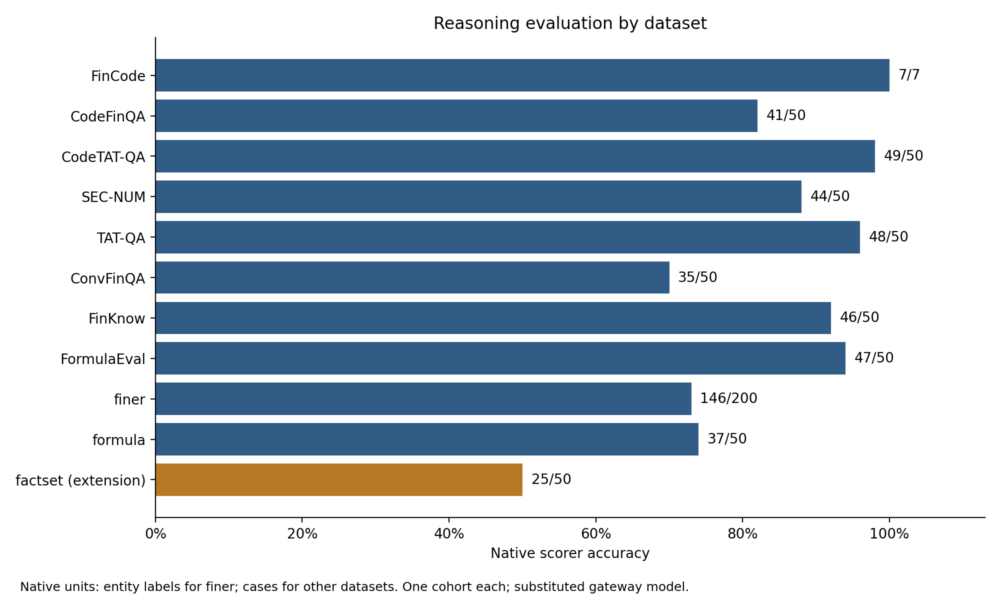

# Stage 3 evaluation results

The native execution checkpoint retains **14 validated tasks and ICBE's invalid-response failure**. The review disposition is to retain that failure under the frozen protocol and proceed to [Stage 4 preparation](STAGE4_PREPARATION.md), without an amended ICBE run. All 507 reasoning cases, EDT, both BeerGame scenarios and all ten Consulting cases are validated. ICBE coverage is incomplete, and four 180-day native Retail episodes remain deferred under the approved 6-credit route. Kaggle primary comparisons have not started.

## Reasoning

These are fresh evaluation runs with the frozen substituted gateway model, native prompts and dataset scorers. All 507 cases produced valid responses and known usage, with no evaluation retries, missing answers or substituted defaults. Native supported coverage is 457 cases across ten datasets; the 50-case Factset extension is separate.

| Dataset | Native accuracy | Native correct / scored units | Exact cases correct / evaluated |
|---|---:|---:|---:|
| FinCode | 100% | 7 / 7 cases | 7 / 7 |
| CodeFinQA | 82% | 41 / 50 cases | 41 / 50 |
| CodeTAT-QA | 98% | 49 / 50 cases | 49 / 50 |
| SEC-NUM | 88% | 44 / 50 cases | 44 / 50 |
| TAT-QA | 96% | 48 / 50 cases | 48 / 50 |
| ConvFinQA | 70% | 35 / 50 cases | 35 / 50 |
| FinKnow | 92% | 46 / 50 cases | 46 / 50 |
| FormulaEval | 94% | 47 / 50 cases | 47 / 50 |
| finer | 73% | 146 / 200 entity labels | 22 / 50 |
| formula | 74% | 37 / 50 cases | 37 / 50 |
| Factset **extension** | 50% | 25 / 50 binary decisions | 25 / 50 |

Each dataset has one evaluation cohort. Native scoring definitions differ, and finer label accuracy must not be interpreted as whole-case accuracy. There is no pooled cross-family score, no claim of reproducing published-model performance, and no independent-run uncertainty estimate. Factset uses the documented local binary scorer and removes provenance hints from the model-visible context.

## EDT

The valid scenario decision was followed by all 96 ABM steps. Terminal accumulated earnings were **−4,836,000**, from revenue of 6,184,000 and expenses of 11,020,000 in native synthetic business units. The native schema normalization did not project the chosen decision. This is one scenario-level decision followed by a rollout, with no within-rollout LLM interventions or real-world causal interpretation.

## BeerGame

Both frozen scenarios completed 25 weeks. Independent offline replay of the actual saved orders matched every observation, transition and native metric; role-level costs sum exactly to the exported chain costs.

| Native opponent scenario | Retailer total cost | Full-chain total cost | Episode retailer bullwhip | Derived time-average retailer backlog |
|---|---:|---:|---:|---:|
| typical | 44,050 | 7,342,656,800 | 38.9227 | 232 |
| smoothing:4 | 49,208.5 | 1,019,970.5 | 47.3880 | 484.84 |

Costs are native simulation monetary units, not gateway credits. The typical heuristic's upstream brewery order reaches 6,527,377,200; the extreme chain total is reproducible native behavior and is retained as a realism limitation. Different opponent configurations and unreplicated LLM decisions prevent causal attribution of their outcome differences.

The native `avg_backlog_controlled` proxy is zero in both scenarios because it repeats the final backlog rather than averaging historical backlog. Actual time averages derived from the weekly observations are shown separately above. The upstream rollup's missing bullwhip, backlog and inventory aggregates remain null; episode bullwhip values are not silently inserted as replacement native aggregates.

## Consulting interruptions

The initial cohort stopped on a gateway HTTP 503 after three judgments. A replacement cohort was terminated between chat turns after seven judgments and left one gateway outcome unknown. A separate-process cohort then stopped on another HTTP 503 after eight judgments. All three retain their observed judgment aggregates, responses, paid attempts and full unknown-charge reservations; none is called a complete cohort.

After the second 503, execution explicitly switched from the initial first-complete-cohort rule to recovery by independent case: use the earliest fully evidenced completed judgment for each frozen case, never the highest score. Eight cases passed raw-evidence revalidation; only the two missing cases need fresh sessions. The memory-free native CoT agent and unchanged ten-case score aggregator make this case-level recovery possible without resuming partial conversations. The execution change and tests are recorded in the [execution record](STAGE3_EVALUATION.md). No uninterrupted first-pass cohort is claimed.

All ten cases are now validated: eight recovered complete sessions and two fresh sessions, each with 12 messages. The final two required 26 new API calls; recovered calls are not charged again in the reporting. Saved native histories and judgments exactly match their re-audited sources. The native mean scores are:

| Judge rubric | Mean score (0–10) |
|---|---:|
| Structure | 8.8 |
| Quantitative reasoning | 7.4 |
| Business sense | 8.3 |
| Communication | 8.2 |
| Overall | 8.15 |

Overall scores range from 8 to 8.5. These are judgments by the substituted interviewer/judge model, not independent human ratings. Ten selected case sessions do not provide independent model replications.

## ICBE validity failure and QC stop

The initial full run stopped at round 20 of its first match on HTTP 503 and cancellation of the paired request. Its 38 valid observed decisions cover 19 complete rounds; both unknown failed-request charges remain fully reserved. Before further calls, the actual pinned simulator reproduced all 38 full requests in an offline probe. Continuation replays these real responses only at identical native requests, reconstructing the same histories and points. New calls begin at unfinished choices. Invalid model decisions cannot be silently resampled through this mechanism, and original source costs are not counted again for replay. See the [execution record](STAGE3_EVALUATION.md).

The continuation stopped at **match 2, round 78, actor B**. DeepSeek returned `finish_reason=length`: all **4,096 output tokens** were consumed, the final content was empty, and there was no explicit decision. This is a charged, observed invalid response, not an unknown transport failure. Its full response and token usage remain in the local audit. No replacement decision, default move, token-limit increase or further paid call was made after this failure.

There are **355 valid logical decisions**, comprising 38 verified replays and 317 fresh valid responses, plus the one invalid response. These cover **177 fully valid rounds**: one complete 100-round match and 77 rounds of the second match. The invalid round is excluded from completed-round counts. The native simulator produced no final workbook, so no full ICBE score or phase-cooperation plot is reported. The remaining choices are unexecuted, not missing answers silently counted as valid.

This continuation used **318 new attempts and 0.292842452 estimated gateway credits**. Across pilots and all evaluations, conservative exposure is **1.934083294 credits**: 1.874999085 known token-derived costs plus 0.059084209 in eight fully retained unknown-charge holds, over 1,438 physical attempts. There are no pending requests. Budget headroom does not authorize changing the frozen response protocol or resampling the invalid choice. Fourteen non-Retail tasks remain validated; ICBE's failed coverage is retained without a replacement cohort, and the four Retail tasks remain deferred.

## Evidence

The [coverage table](results/native_coverage.csv), [aggregate evaluation evidence](results/stage3/evaluation_cohorts.json) and [inclusive budget summary](results/stage3/budget_summary.json) retain current completion and expense denominators. The [executed analysis notebook](../notebooks/05_native_evaluation.ipynb) checks aggregate hashes and runs without credentials or paid calls. Request-level artifacts and account metadata remain local.

The [execution plan](STAGE3_EVALUATION.md) records scope, compatibility adapters and quality gates. All 59 automated tests passed at the reasoning checkpoint, 63 after Consulting recovery, and 66 after exact-request ICBE replay. Four original Retail evaluations remain outstanding regardless of the non-Retail route's eventual completion.
